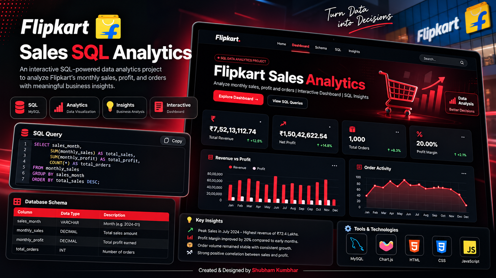
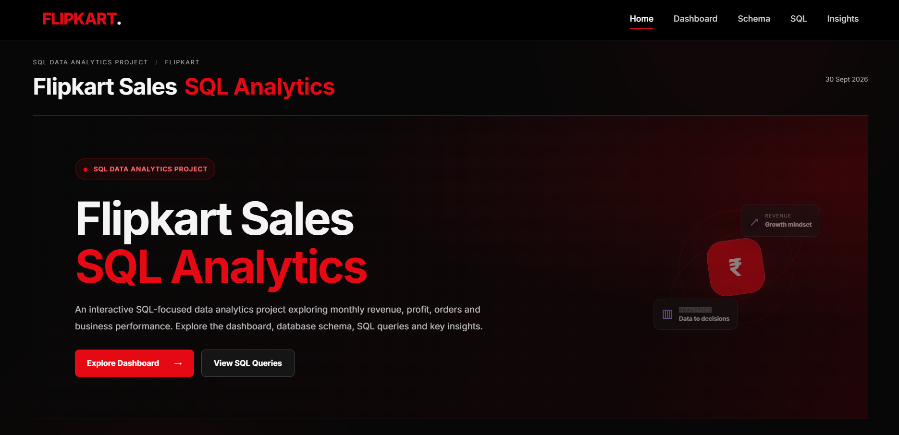
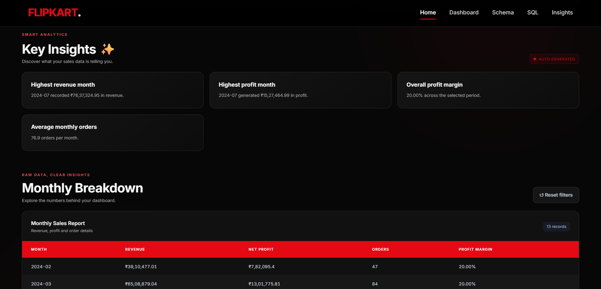
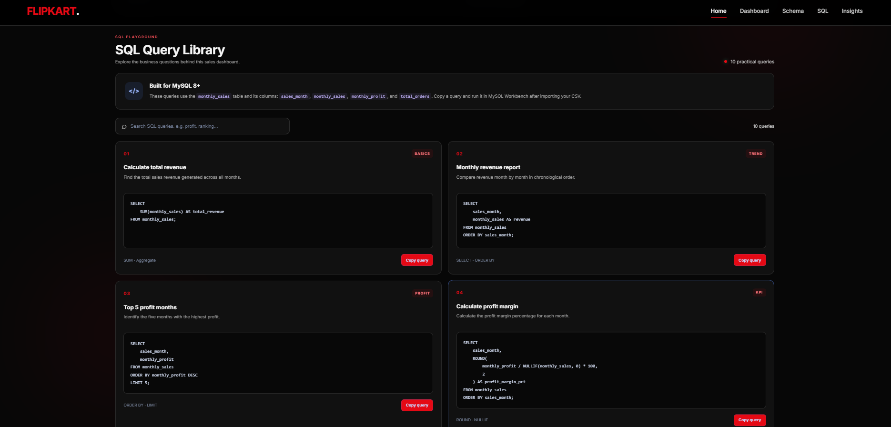

# Flipkart Sales SQL Analytics

An interactive, SQL-focused sales analytics project built to explore revenue, profit, orders, and monthly business performance.

## Project Preview

## Dashboard

Explore monthly revenue, net profit, total orders, and profit margin through interactive charts.

## Key Business Insights

The dashboard highlights the highest-revenue month, highest-profit month, overall profit margin, and average monthly orders.

## SQL Analysis

The project includes SQL queries covering:

- SELECT, WHERE, ORDER BY
- Aggregate functions: SUM, AVG, MIN, MAX
- GROUP BY and HAVING
- CASE WHEN
- Subqueries and CTEs
- Window functions such as RANK() and LAG()

## Dataset

The monthly dataset includes sales_month, monthly_sales, monthly_profit, and total_orders.

## Tools & Technologies

SQL / MySQL, HTML, CSS, JavaScript, Chart.js, Git, and GitHub.

## How to Run

1. Clone or download this repository.
2. Open the project folder in VS Code.
3. Run index.html using Live Server.
4. Keep monthly_sales.csv in the same folder.

## Author

**Shubham Kumbhar**

[GitHub](https://github.com/SK-datahub) · [LinkedIn](https://www.linkedin.com/in/sk-datahub/)

Created & Designed by Shubham Kumbhar.
